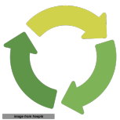

---
# Feel free to add content and custom Front Matter to this file.
# To modify the layout, see https://jekyllrb.com/docs/themes/#overriding-theme-defaults
layout: home
nav_order: 1
title: "Open, Client-Owned Analytics for Operational Decisions"
description: "Independent advisory for diagnosing underperforming analytics, designing statistically defensible solutions, and building maintainable systems that clients own."
keywords: "operational analytics, statistical learning, analytical architecture, open-source machine learning, KMDS, tseda, drift remediation"
permalink: "/"
og_type: website
---
# Reliable Operational Decisions, Without Platform Lock-In

**Independent analytics advisory from a PhD-trained machine learning practitioner with 25+ years of engineering and analytical experience.** I help U.S. enterprises and global capability centers in Chennai and Bengaluru turn underperforming data initiatives into explainable, reproducible systems that teams can own and operate.

[Book a 20-minute diagnostic call](https://calendly.com/rajiv-sambasivan) · [Review case studies](https://github.com/rajivsam/kmds_migration) · [Explore the methodology](/methodology/)

## Statistical Learning Built for the Real Decision

Analytics initiatives often fail because the solution does not reflect the business process, data structure, validation requirements, or operational consequences. I focus on those gaps: problem framing, feature design, model selection, validation, monitoring, and maintenance.
{: .text-justify}

R2-DS combines established statistical learning with disciplined software engineering. The result is a reusable, auditable solution that your organization can inspect, operate, extend, and own—without unnecessary model complexity or platform dependence.
{: .text-justify}

  
A brief introduction to my background and approach.

  

    <iframe src="https://www.youtube.com/embed/cporvnttK1U" title="Rajiv Sambasivan on the KMDS approach" frameborder="0" allow="accelerometer; autoplay; clipboard-write; encrypted-media; gyroscope; picture-in-picture; web-share" allowfullscreen style="position: absolute; top: 0; left: 0; width: 100%; height: 100%;"></iframe>
  

## Practical Evidence, Not Model Hype

Real data may contain imbalance, hidden subpopulations, correlated features, inconsistent semantics, and changing operating conditions. The useful question is not "Which algorithm should we run?" but:

- What decision must the model support?
- What structure and limitations exist in the data?
- Which signals are relevant to the business process?
- How will success be measured in operation?
- What will reveal that the assumptions are no longer valid?

### SBA Loan Analytics: Focus Scarce Review Capacity

The [SBA Loan Analytics example](https://github.com/rajivsam/kmds_migration) began with weak discrimination and a requirement to review the full population. Disciplined feature selection and validation changed the operating result:

- **Validation PR-AUC:** 0.1673 to 0.7560
- **Defaults captured on held-out data:** 82.46%
- **Population requiring review:** 19.55%

The full [performance report](https://github.com/rajivsam/kmds_migration/blob/main/sba_migration/agent_documents/sba_performance_report_summary.md) and [technical overview](https://rajivsam.github.io/kmds_migration/kmds_insights_article.html) show how the result was constructed and evaluated.

This is more than a better benchmark. It creates a practical review queue that directs limited capacity toward the cases most likely to create loss.

### Olist Demand Segmentation: Find the Exceptions That Deserve Attention

The [Olist regional demand segmentation example](https://github.com/rajivsam/kmds_migration/blob/main/olist_migration/documents/olist_usecase_summary.md) reduced 112,650 order-item records to a coherent 2017 São Paulo study containing 20,044 transactions. The analysis converted the transactions into a weekly demand matrix with 52 observations and 9,367 candidate product-revenue features. A geometry and feature-redundancy audit removed 8,497 columns, leaving 870 product features for analysis.

The current result identifies four weekly demand regimes:

- **Regime 0:** 23 weeks (44.2% of the year)
- **Regime 1:** 12 weeks (23.1%)
- **Regime 2:** 9 weeks (17.3%)
- **Regime 3:** 8 weeks (15.4%)

Here, the retained product IDs are features that distinguish the week regimes; they are not products assigned to four product clusters. The result gives assortment and inventory planners an auditable queue for investigating which retained products, weeks, and calendar conditions warrant further review. It supports testing regime-specific operating policies, but it does not by itself establish a causal explanation, forecast improvement, or inventory savings. Those conclusions require repeated-run stability checks and enrichment with margin, lead-time, service-level, promotion, and stockout data.

## How I Help

### 1. Frame the Real Problem

I translate an operational concern into explicit statistical tasks, decision criteria, and validation requirements. The work begins with the process generating the data—not with a preferred model or platform.

### 2. Build the Analytical Architecture

I identify relevant features, data structures, sources of heterogeneity, candidate models, and failure conditions. The objective is to create a defensible architecture that reflects the actual decision and can be explained to technical and business stakeholders.

### 3. Make the Solution Reproducible

The solution is implemented as a structured, versioned workflow. Data preparation, feature definitions, modeling decisions, validation results, and deployment requirements remain visible and recoverable rather than residing in an individual notebook or vendor environment.

### 4. Keep It Honest in Operation

A model can deteriorate when the underlying process changes. Monitoring includes performance, data drift, feature stability, concept drift, and the continuing validity of the business assumptions. When change is detected, the response is explicit: recalibrate, redesign, or retire the affected component.

## Open Tools, Client Ownership

The underlying components are open source and designed for reuse:

- **[KMDS](https://github.com/rajivsam/kmds_migration)** provides a structured, reproducible workflow for analytical projects, including documented decisions, reusable project components, and agent-assisted execution.
- **[Imbalanced Feature Screener](https://github.com/rajivsam/imbalanced_feature_screener)** identifies discriminative features in imbalanced datasets, supporting focused feature contracts where rare outcomes make conventional screening unreliable.
- **[tseda](https://github.com/rajivsam/tseda)** supports analyst-guided time-series decomposition with explicit statistical traceability.
- **[Count TS Window Selector](https://github.com/rajivsam/count_ts_window_selector)** selects a homogeneous Poisson-process window from a time series of arrivals, helping teams distinguish stable operating periods from regime changes.
- **[Cluster Feature Analysis](https://github.com/rajivsam/cluster_feature_analysis)** investigates cluster geometry and feature redundancy, removes redundant features, and recommends an appropriate clustering approach and distance measure.
- **[Structure Identification for CS Data](https://github.com/rajivsam/structure_identification_for_CS_data)** helps expose hidden dependencies, segmentation, and changes in datasets before they distort modeling results.

The same workflow can support different business domains while retaining the discipline around data understanding, feature engineering, modeling, validation, and maintenance. Your organization retains the code, configuration, documentation, and analytical logic.
{: .text-justify}

## A Practical Approach to AI

Agentic tools are used throughout the work to accelerate exploration, implementation, documentation, and repetitive engineering. They do not replace expert accountability. Human judgment remains responsible for defining the decision, recognizing misleading patterns, selecting appropriate validation, and deciding whether a result is ready for operational use.
{: .text-justify}

The same principle applies to foundation models. They can provide a useful baseline, support cold starts, or transfer patterns when there is strong repeated structure across tasks. They are not automatically preferable to a well-designed model trained on your own data. The right choice depends on business value, explainability, data characteristics, infrastructure, and maintenance cost. See [Foundation Models for Tabular Data](https://r2dssanity.substack.com/p/foundation-models-for-tabular-data) for a fuller discussion.
{: .text-justify}

## Ways to Engage

### Analytical Systems Audit — 2 to 3 Weeks

For a team that has data or an existing model but is uncertain why results are weak, unstable, or difficult to trust, the audit can include:

- Mapping the operational decision and expected business impact
- Reviewing data structure, feature definitions, and sources of risk
- Assessing class imbalance, heterogeneity, leakage, drift, and validation
- Benchmarking the current approach against credible alternatives
- Identifying the highest-value corrective actions
- Delivering a prioritized architecture and implementation roadmap

The audit is intended to give decision-makers a clear answer: **what is failing, why it is failing, and what should be done next.**

### Solution Development Kickoff

For a defined opportunity, the next step can be a focused solution kickoff covering the problem definition, statistical design, reproducibility structure, feature strategy, evaluation plan, and first implementation backlog. The engagement is structured around a durable capability rather than a disposable proof of concept.

R2-DS works with U.S. enterprises and global capability centers (GCCs), including teams in Chennai and Bengaluru. Engagements can be structured through a direct independent-contractor agreement or a corporation-to-corporation arrangement, subject to the requirements of the parties.
{: .text-justify}

### For GCC Leaders

I help GCC data science and engineering teams turn local delivery work into systems that headquarters can trust:

- Align analytical work with the operational decision owned by U.S. or global stakeholders
- Make assumptions, validation, and limitations visible across teams and time zones
- Create reproducible handoffs that reduce dependence on individual analysts
- Build auditable evidence of technical quality and business relevance

The result is not just faster execution. It is headquarters-ready analytical work with clearer governance, stronger continuity, and a direct connection to business decisions.

## Why Work With R2-DS

- **Business decision before technical method** — the statistical work is tied to a real operating choice.
- **Transparent analytical architecture** — results can be inspected, challenged, reproduced, and maintained.
- **Reusable engineering** — the solution is designed as a capability, not as an isolated experiment.
- **Client ownership** — code, knowledge, and analytical logic remain with the organization.
- **Experienced judgment** — 25+ years of engineering and analytical experience across retail, telecom, transport, finance, government, and software tools.
- **Sustained technical foundation** — formal PhD-level training in machine learning and publications in statistical learning, graph-oriented systems, optimization, and enterprise-scale machine learning.

{:refdef: style="text-align: center;"}

{: refdef}

---

## Start With the Decision

If an analytics system is underperforming, difficult to trust, or ready to become an owned capability, start with a focused 20-minute diagnostic conversation—no pitch deck. We will clarify the decision, identify the likely constraints, and determine whether an audit or solution kickoff is appropriate.

[Book a 20-minute diagnostic call](https://calendly.com/rajiv-sambasivan)

[LinkedIn](https://www.linkedin.com/in/rajiv-sambasivan/) · [GitHub](https://github.com/rajivsam/) · [Google Scholar](https://scholar.google.com/citations?user=96db8S4AAAAJ&hl=en)
