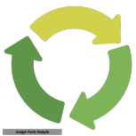

---
# Feel free to add content and custom Front Matter to this file.
# To modify the layout, see https://jekyllrb.com/docs/themes/#overriding-theme-defaults
layout: home
nav_order: 1
title: "Open-Platform Advisory for Data-Driven Operations"
description: "Independent advisory for analytical architecture, statistical mapping, and drift remediation using open-source KMDS and tseda frameworks."
keywords: "open-platform advisory, statistical architecture, drift remediation, KMDS, tseda, operational analytics consulting"
permalink: "/"
og_type: website
---
# Open-Platform Advisory for Operational Intelligence

## Statistical Approaches for Operational Decisions

I help CTOs and engineering leaders turn operational data into analytical systems that are statistically defensible, auditable, and maintainable. The underlying platform remains open and client-owned through [KMDS](https://github.com/rajivsam/kmds_migration) and [tseda](https://github.com/rajivsam/tseda), so the team keeps the engine without a permanent software platform bill. The real value is not software rental; it is the intellectual capital required to map the decision correctly, define the right feature logic, and maintain the model as the operating environment changes.
{: .text-justify}

[Book a call](https://calendly.com/rajiv-sambasivan) · [Read the methodology](/methodology/) · [Read the perspectives](/essays/)

I help technical leaders turn operational data into analytical systems that are statistically defensible, auditable, and maintainable. My open-source foundations — [KMDS](https://github.com/rajivsam/kmds_migration) and [tseda](https://github.com/rajivsam/tseda) — give teams an immediately usable analytical engine without a permanent software platform bill. The real value is not software rental. It is the intellectual capital required to map the decision correctly, define the right feature logic, and maintain the model as the operating environment changes.
{: .text-justify}

This is a direct advisory model for organizations that need analytical rigor, not a vendor lock-in relationship. I provide the initial mathematical architecture, the drift and gap analysis, and the ongoing calibration required to keep the model aligned with reality. See the [methodology](/methodology/) for how the work is structured, and the [Perspectives on AI and Analytics](/essays/) for practical examples of how these systems are thought about in real operational settings.
{: .text-justify}

I am not selling a subscription. I am selling the judgment that created the architecture in the first place and the expertise required to keep it honest as the data-generating process changes.
{: .text-justify}

### The Open-Platform Advisory Framework

**The Core Principle**

I help organizations convert operational complexity into rigorous statistical learning problems without the burden of proprietary platform lock-in. The open framework is designed for transparency, auditability, and long-term ownership by the client.
{: .text-justify}

**Where I Engage**

- **Phase 1: Initial Solution Mapping** — I translate physical, industrial, or enterprise use cases into tractable statistical learning problems and build feature sets that reflect the true operating system rather than superficial proxy variables.
- **Phase 2: Drift & Gap Analysis** — I identify when data drift, concept drift, or structural degradation are beginning to invalidate the model’s assumptions.
- **Phase 3: Remediation & Calibration** — I rework feature definitions, decomposition windows, and model assumptions so the analytical system remains stable and decisionally valid in production.

**The Open Assets**

- **KMDS**: A knowledge-centric framework for transparent, reproducible machine learning workflows and operationally grounded feature definition.
- **tseda**: A Python package for analyst-guided time-series decomposition, allowing teams to separate trend, seasonality, and noise while preserving explicit statistical traceability.

### Why This Model Is Technically Credible

1. **The solution is not obscured** — it is built in an open-source framework that the client can inspect, run, and adapt without vendor dependency, which creates immediate trust in the underlying approach.
2. **Drift is the recurring value source** — The real question is not whether the model works at launch; it is whether it remains valid as underlying conditions shift. That is where the advisory value continues.
3. **I am not selling implementation labor** — I do not position myself as a general software vendor or agency resource. I operate as a specialist in analytical architecture, modeling rigor, and statistical maintenance.
4. **The charge is for intellectual capital, not software rental** — My engagement is framed around mathematical design, calibration, and operational maintenance, not seat licenses or platform subscriptions.

### Perspectives on AI and Analytics

I write practical, grounded commentary on the real work of building useful AI and analytics systems: where the business problem starts, how the data becomes a model, and what it takes to turn a promising idea into something reliable enough to operate.
{: .text-justify}

If you are interested in my perspectives on AI — especially how generative AI and LLM tools can work alongside a data scientist to support real analytical work — see the [Perspectives on AI and Analytics page](/essays/).
{: .text-justify}

### Consulting Offering

I work with CTOs, VP-level engineering leaders, and operating teams that already have the data but do not yet have a statistically defensible architecture for turning it into reliable decisions. My work begins with the question that most technical programs skip: what is the actual decision process, and what statistical structure is required to keep that decision valid as the operating environment changes?
{: .text-justify}

You bring the business context, the operational history, and the pressure to make better decisions at scale. I translate that context into feature engineering, model structure, and analytical architecture that are explainable, auditable, and sustainable. Because the foundation is open and owned by your organization, the resulting analytical logic remains inside the company rather than being trapped inside a vendor platform.
{: .text-justify}

The highest-value engagements are not general software delivery projects. They are focused advisory engagements around **featurization**, **model mapping**, and **drift remediation**. I design feature sets, interaction terms, correlation-adjusted signals, and transaction- or sensor-ready datasets that improve model quality and create a more defensible operating system for production decisions.
{: .text-justify}

For many organizations, the most valuable work is **mathematical maintenance**: determining whether the model is still measuring the same thing, whether the feature definitions still reflect the real process, and whether recalibration is required before the system drifts into poor decisions that are difficult to trace back to their source.
{: .text-justify}

  
Watch a short video describing my background and approach.

  

    <iframe src="https://www.youtube.com/embed/cporvnttK1U" title="Overview of KMDS approach" frameborder="0" allow="accelerometer; autoplay; clipboard-write; encrypted-media; gyroscope; picture-in-picture; web-share" allowfullscreen style="position: absolute; top: 0; left: 0; width: 100%; height: 100%;"></iframe>
  

{:refdef: style="text-align: center;"}

{: refdef}

---

## Background

25+ years of engineering experience developing analytical solutions across retail, telecom, transport, finance, government, and software tools, plus formal PhD-level training in machine learning. Selected publications spanning scalable statistical learning, graph-oriented analytical systems, optimization, and enterprise-scale ML infrastructure are available on [Google Scholar](https://scholar.google.com/citations?user=96db8S4AAAAJ&hl=en).

---

## Let's Talk

If your team already has data, operational pressure, and an unclear statistical approach, I can help you define the right path and keep it valid as conditions change. [Book a call](https://calendly.com/rajiv-sambasivan) to discuss the problem, the decision process, the data reality, and the remediation path.

I work with CTOs, engineering leaders, and technical operators on focused advisory engagements around analytical strategy, feature design, model mapping, and drift remediation. My engagements are structured for clarity and precision, not low-value implementation labor.

> Note: I provide strategic ML advisory and specialized decision architecture directly to enterprise clients. I do not take on general implementation-tier projects, staff augmentation roles, or W2 agency placements. Third-party brokers and staffing firms seeking to place resources or support general delivery work will not be considered.

[LinkedIn](https://www.linkedin.com/in/rajiv-sambasivan/) · [GitHub](https://github.com/rajivsam/) · [Google Scholar](https://scholar.google.com/citations?user=96db8S4AAAAJ&hl=en)

---

## Real-World Example

If you would like to see how this methodology can be applied to a real-world dataset, check out the [SBA Loan Analytics example](https://github.com/rajivsam/kmds_migration) and the [technical overview article](https://rajivsam.github.io/kmds_migration/kmds_insights_article.html).

The broader context for the approach is available in the [methodology](/methodology/) and [Perspectives on AI and Analytics](/essays/) sections.

---
