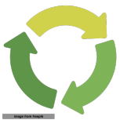

---
# Feel free to add content and custom Front Matter to this file.
# To modify the layout, see https://jekyllrb.com/docs/themes/#overriding-theme-defaults
layout: home
nav_order: 1
title: "Operational Analytics for Monthly and Quarterly Decision Making"
description: "Transform operational data into repeatable analytical systems for monthly and quarterly decision-making."
keywords: "operational analytics consulting, repeatable analytical systems, operational data modernization, analytical workflow design"
permalink: "/"
og_type: website
---
# Practical AI and Operational Analytics for Real Decisions

Most AI programs do not fail because the models are weak. They fail because the use case is poorly framed, the data is not operationally understood, and the system is built without the knowledge needed to maintain it. I help organizations turn operational data into repeatable analytical systems that support real business decisions — not just technical demos.
{: .text-justify}

I work directly with teams that need clarity on where to start, what to model, and how to structure the underlying data and feature definitions so the solution is explainable, auditable, and sustainable. My work combines machine learning, decision systems design, and operational analytics, with a strong emphasis on featurization, model quality, and practical implementation.
{: .text-justify}

I use Knowledge-Centric Machine Learning Systems (KMDS) as the framework underneath the work — a methodology for building ML products with transparency, reproducibility, and operational discipline from day one. The goal is not to chase AI hype; it is to build the analytical system your team can actually run, defend, and improve over time.
{: .text-justify}

### Perspectives on AI and Analytics

I write practical, grounded commentary on the real work of building useful AI and analytics systems: where the business problem starts, how the data becomes a model, and what it takes to turn a promising idea into something reliable enough to operate.
{: .text-justify}

If you want a more candid view of how AI and analytics actually get built in practice — beyond product marketing, vendor hype, and generic productivity talk — see the [Perspectives on AI and Analytics page](/essays/) for the full set of essays and discussion.
{: .text-justify}

- [Beyond the Agent Illusion: Leveraging AI Systems for Real Operational Value](https://r2dssanity.substack.com/p/beyond-the-agent-illusion-leveraging?r=3ncgel) — A comparison of two ways to build intelligent systems: the AI-first, agentic view and the data-science view. There are niches such as self-driving cars and robotics where the agentic approach is essential, but in most enterprise operations — especially where decisions must be explained to business users and operators — the data-science view is the more practical and defensible path.
- [From Business Use Case to Technical Implementation](https://r2dssanity.substack.com/p/from-business-use-case-to-technical?r=3ncgel) — Turning business problems into tractable analytical systems, with attention to constraints, data realities, and measurable outcomes.
- [From Task-Specific Data to Modeling](https://r2dssanity.substack.com/p/from-task-specific-data-to-modeling?r=3ncgel) — How raw operational data becomes the modeling substrate, and why task framing matters as much as the algorithm.
- [Modeling and Featurization](https://r2dssanity.substack.com/p/modeling-and-featurization?r=3ncgel) — The design choices that shape model quality, especially where feature engineering is the difference between signal and noise.

The longer-form version of this thinking lives on the [Perspectives on AI and Analytics page](/essays/), where each piece sits within a broader set of practical views on operational analytics and AI systems.
{: .text-justify}

### Consulting Offering

KMDS is free to use and gives teams a strong baseline for feature engineering and modeling workflows without upfront licensing costs. It accelerates exploration and makes data preparation more accessible. Please see the following [post](https://rajivsam.github.io/r2ds-blog/posts/kmds_update_1/) for a description of how KMDS fits into implementing a machine learning use case.

You bring the operational problem and the data history. I translate that business problem into the precise feature engineering, statistical models, or graph structures required to solve it. Because I use the open KMDS framework, the resulting analytical definitions and system logic stay inside your company—giving you enterprise-grade decisions without the permanent software platform bill.

With an ML expert, the value is in choosing the right inputs and shaping the model for your business use case in a way that is interpretable, maintainable, and auditable.

My consulting practice builds on that foundation with a focus on **featurization** — the critical step that drives model performance. I deliver curated feature sets, interaction terms, correlation-adjusted features, and vectorized datasets ready for downstream modeling, so your models start with the strongest possible inputs.

For clients seeking end-to-end solutions, I also provide **modeling support**. From classification and regression to survival analysis and panel data models, I help teams move seamlessly from feature engineering to production-ready systems.

<div style="max-width: 900px; margin: 2rem auto;">
  <p style="text-align: center; font-weight: 600; margin-bottom: 1rem;">Watch a short video describing my background and approach.</p>
  <div style="position: relative; padding-bottom: 56.25%; height: 0; overflow: hidden;">
    <iframe src="https://www.youtube.com/embed/cporvnttK1U" title="Overview of KMDS approach" frameborder="0" allow="accelerometer; autoplay; clipboard-write; encrypted-media; gyroscope; picture-in-picture; web-share" allowfullscreen style="position: absolute; top: 0; left: 0; width: 100%; height: 100%;"></iframe>
  </div>
</div>

{:refdef: style="text-align: center;"}

{: refdef}

---

## Who I Help

- Teams evaluating Dataiku, DataRobot, or similar platforms who are hesitant on cost or implementation time
- Organizations that already own a platform license but need hands-on help getting value from it
- Organizations with operational data collected daily, weekly, or monthly
- Leaders who need consistent definitions, lineage, and explainable decisions — without the platform overhead
- Groups focused on lending, customer analytics, operations, forecasting, service delivery, or asset management

---

## How I'm Different From a Platform

A platform sells you software and leaves the thinking to your team. I do the thinking *and* build the system — direct engagement, no seat licenses, no minimum contract tiers.
{: .text-justify}

I use Knowledge-Centric Machine Learning Systems (KMDS) as the framework underneath the work — a methodology for delivering ML products with auditability, transparency, and reproducibility built in from day one. Because operational data is rarely clean or static, the real value comes from capturing and structuring the analytical knowledge, feature definitions, and data dependencies that make a solution sustainable long after the engagement ends.
{: .text-justify}

[Explore the full KMDS methodology →](https://www.r2-ds.com/methodology/)

---

## Featured Example: SBA Loan Analytics

Raw SBA loan data becomes the example for a repeatable operational analytics workflow — the same kind of system a platform would charge enterprise rates to build.
{: .text-justify}

```text
Raw SBA Loan Dataset
       ↓
Dataset Understanding
       ↓
Entity Identification
       ↓
Cleaning Recommendations
       ↓
Feature Engineering
       ↓
Modeling Ready Dataset
       ↓
Knowledge Preservation
       ↓
Repeatable Business Decisions
```

See the [KMDS migration repository](https://github.com/rajivsam/kmds_migration) and [technical overview article](https://rajivsam.github.io/kmds_migration/kmds_insights_article.html) for details.

---

## Technical Focus Areas

- Statistical Learning Systems
- Graph Machine Learning
- Analytical Infrastructure
- Optimization & Recommendation Systems
- Explainable AI Systems
- Knowledge Graph Systems for ML and AI explainability and traceability

---

## Background

25+ years of engineering experience developing analytical solutions across retail, telecom, transport, finance, government, and software tools, plus formal PhD-level training in machine learning. Selected publications spanning scalable statistical learning, graph-oriented analytical systems, optimization, and enterprise-scale ML infrastructure are available on [Google Scholar](https://scholar.google.com/citations?user=96db8S4AAAAJ&hl=en).

---

## Let's Talk

If you're weighing the cost of a Dataiku or DataRobot license — or already have one and need someone to make it work — [let's talk](https://calendly.com/rajiv-sambasivan) about a direct engagement. I am available on both 1099 and C2C basis.

Available for contract and advisory engagements.

[LinkedIn](https://www.linkedin.com/in/rajiv-sambasivan/) · [GitHub](https://github.com/rajivsam/) · [Google Scholar](https://scholar.google.com/citations?user=96db8S4AAAAJ&hl=en)
